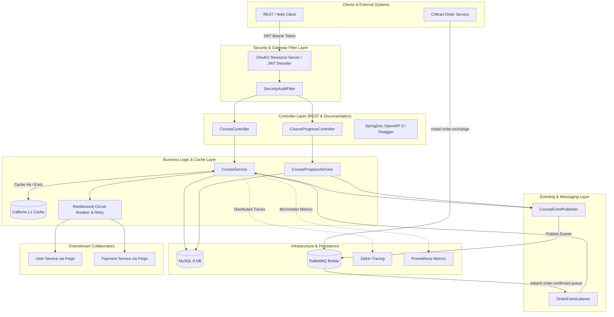
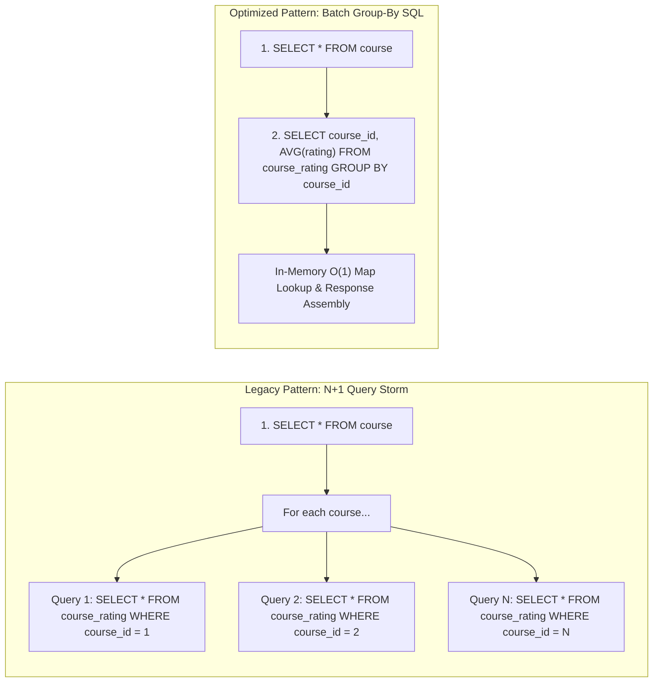
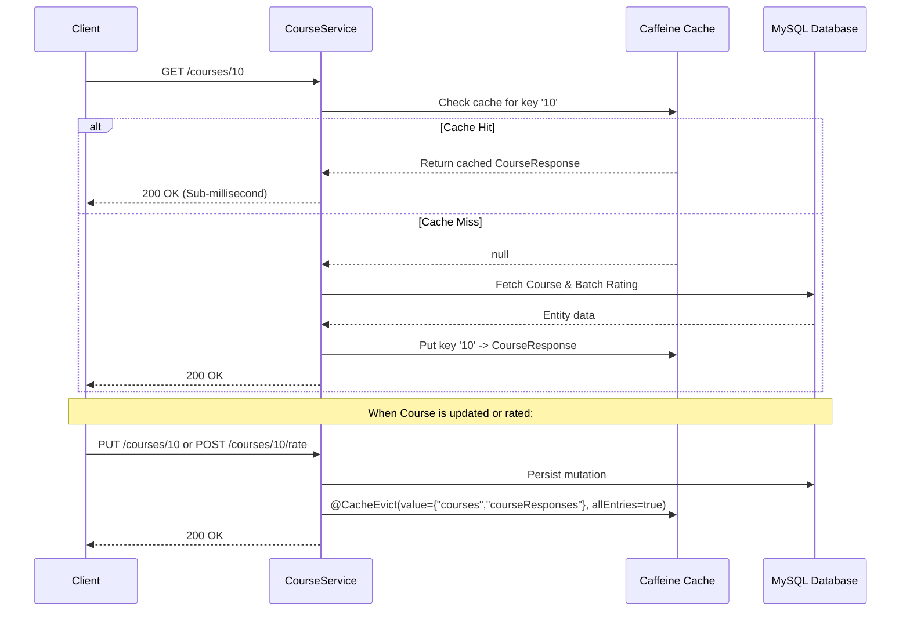
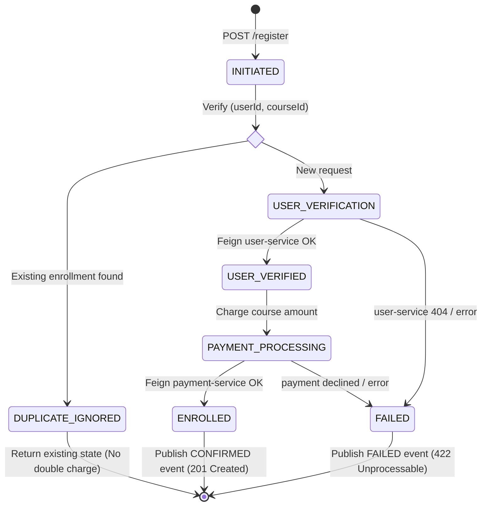
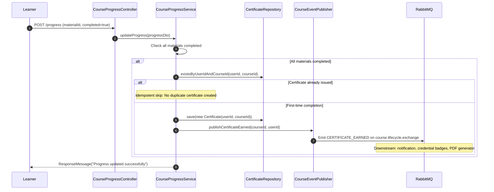
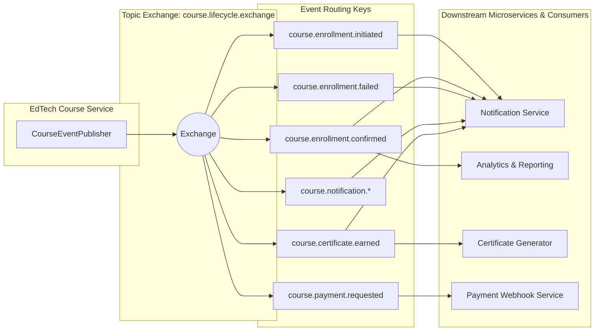
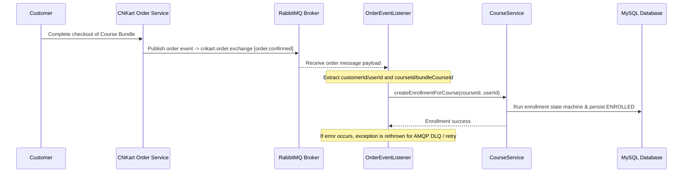
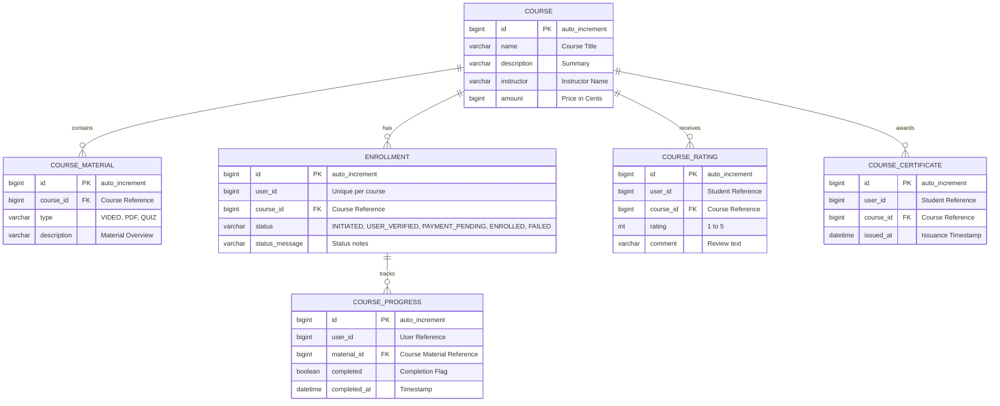

# Course Service


A production-grade **LMS backend microservice** built with Spring Boot. It models the full lifecycle of online courses — from catalog management, pagination, and multi-state student enrollment to progress tracking, idempotent certificate issuance, peer reviews, and in-memory caching — exposing all workflows via clean REST endpoints backed by a resilient, event-driven architecture.

> Enrolling a student in a course spans user identity verification, payment settlement, idempotency guards, circuit breakers, and event notifications. This service coordinates all of it with zero direct coupling to downstream collaborators.

---

## Table of Contents

- [What It Does](#what-it-does)
- [Architecture Overview](#architecture-overview)
- [Performance & Caching Architecture](#performance--caching-architecture)
  - [N+1 Query Elimination](#n1-query-elimination)
  - [Caffeine Cache-Aside Pattern](#caffeine-cache-aside-pattern)
- [API Reference](#api-reference)
- [Enrollment State Machine](#enrollment-state-machine)
- [LMS Features — Progress, Certificates, Ratings](#lms-features)
  - [Progress Tracking](#1-progress-tracking)
  - [Idempotent Certificate Issuance](#2-idempotent-certificate-issuance)
  - [Ratings & Reviews](#3-ratings--reviews)
- [Event-Driven Architecture](#event-driven-architecture)
- [Cross-Repo Integration (CNKart → EdTech)](#cross-repo-integration)
- [Security & Role-Based Access Control (RBAC)](#security--role-based-access-control-rbac)
- [Observability](#observability)
- [Data Model & ER Diagram](#data-model--er-diagram)
- [Running Locally](#running-locally)
- [Testing & Quality Assurance](#testing--quality-assurance)
- [Tech Stack](#tech-stack)

---

## What It Does

| Capability | Description |
|---|---|
| 📚 Course Catalog | Create, update, delete, paginate (`page`, `size`), and search courses by ID, name, or instructor |
| ⚡ In-Memory Caching | Caffeine caching on hot catalog read paths with automatic eviction on write mutations |
| 🚀 N+1 Optimization | Batch group-by SQL queries for rating aggregations and single-query progress counting |
| 🎓 Student Enrollment | Full 4-state machine (`INITIATED` → `USER_VERIFIED` → `PAYMENT_PENDING` → `ENROLLED`) with duplicate protection |
| ✅ Progress Tracking | Students complete materials; progress tracked per user with real-time completion checks |
| 🏆 Idempotent Certificates | `Certificate` entity backed by DB unique constraint prevents duplicate issuance |
| ⭐ Ratings & Reviews | Domain-gated: only enrolled students can rate; pre-aggregated averages served on responses |
| 📡 Event Publishing | RabbitMQ lifecycle events broadcasted on `course.lifecycle.exchange` |
| 🔗 Cross-Repo Trigger | Listens for CNKart `order.confirmed` topic → auto-enrolls buyer in a course bundle |
| 🔒 Security & RBAC | OAuth2 Resource Server + JWT, `@PreAuthorize` method security (`ADMIN`, `INSTRUCTOR`), and audit logging |
| 🛡️ Resilience & Fault Tolerance | Resilience4j circuit-breaker + retry with proper HTTP 503 fallback semantics |
| 🔍 Observability | Spring Cloud Sleuth + Zipkin distributed tracing, Micrometer + Prometheus metrics |
| 🧪 Testcontainers Integration | Real MySQL and RabbitMQ container integration test suites in CI |

---

## Architecture Overview



---

## Performance & Caching Architecture

### N+1 Query Elimination

In previous iterations, fetching course catalogs incurred an **$O(N)$ query storm**: for every course, a separate database query was fired to fetch ratings and compute the average. Progress checks similarly fetched all materials and iterated across individual progress rows.



#### Code Implementation
- **Ratings Batch Aggregation**: `CourseRatingRepository.getAllAverageRatings()` executes a single JPQL projection query returning a `Map<Long, Double>` lookup:
  ```java
  @Query("SELECT new EdTech.Course.dto.CourseRatingSummary(r.courseId, AVG(r.rating)) FROM CourseRating r GROUP BY r.courseId")
  List<CourseRatingSummary> getAllAverageRatings();
  ```
- **Single-Query Progress Calculation**: `CourseProgressRepository.countCompletedMaterialsByUserIdAndCourseId(userId, courseId)` replaces memory-heavy stream scans with a direct database count:
  ```sql
  SELECT COUNT(cp) FROM CourseProgress cp WHERE cp.userId = :userId AND cp.materialId IN (...) AND cp.completed = true
  ```

---

### Caffeine Cache-Aside Pattern

Hot read paths for course catalog responses are cached in an in-memory Caffeine cache (`maximumSize=1000`, `expireAfterWrite=10m`). Write operations immediately evict cached entries to prevent stale state.



---

## API Reference

### Course Catalog & Discovery

| Method | Path | Auth / Role | Description |
|---|---|---|---|
| `GET` | `/courses` | Public | List all courses with average ratings (supports `?page=0&size=20`) |
| `GET` | `/courses/{id}` | Public | Get single course by ID with cached average rating |
| `GET` | `/courses/name?name=` | Public | Search course by name |
| `GET` | `/courses/instructor?instructor=` | Public | Search course by instructor |
| `GET` | `/courses/{id}/materials` | Public | Get all learning materials for a course |
| `POST` | `/courses` | `ADMIN`, `INSTRUCTOR` | Create a course with materials and initial settings |
| `PUT` | `/courses/{id}` | `ADMIN`, `INSTRUCTOR` | Update course details (evicts cache) |
| `DELETE` | `/courses/{id}` | `ADMIN` | Delete course by ID (evicts cache) |

### Enrollment & Learning Lifecycle

| Method | Path | Auth / Role | Description |
|---|---|---|---|
| `POST` | `/courses/course/{courseId}/register/{userId}` | Authenticated | Register student; runs 4-stage enrollment workflow |
| `POST` | `/progress` | Authenticated | Mark learning material completed; triggers auto-certification |
| `GET` | `/progress/{userId}` | Authenticated | Retrieve user learning progress across materials |
| `POST` | `/courses/{courseId}/rate` | Enrolled Student | Submit rating (1–5) and review comment |

---

## Enrollment State Machine

Enrollment is modeled as an **explicit state machine** persisted at every step. Transient downstream network issues trigger the circuit breaker fallback without leaving corrupted or duplicate records.



### Resilience & Circuit Breaker Fallback
If the downstream `user-service` or `payment-service` experiences an outage:
- Resilience4j opens the circuit breaker after consecutive threshold breaches.
- The fallback method returns **HTTP 503 Service Unavailable** with an explicit error message (`Services not available: downstream failure`), preventing inaccurate success codes.

---

## LMS Features

### 1. Progress Tracking
Learners advance through material units sequentially. The service enforces that a user must be in an `ENROLLED` status before accepting completion ticks.

```json
POST /progress
{
  "userId": 42,
  "materialId": 7,
  "completed": true
}
```

---

### 2. Idempotent Certificate Issuance

When a student marks the final course material completed, the system evaluates completion and issues a verifiable certificate.



---

### 3. Ratings & Reviews
- **Anti-Spam Verification**: Only learners with an existing `ENROLLED` record can review a course.
- **Single Review Constraint**: A database unique constraint on `(user_id, course_id)` prevents vote duplication.
- **Instant Eviction**: Submitting a rating invalidates cached course cards to immediately reflect the recalculated average.

---

## Event-Driven Architecture

### Outbound Events Topology



---

## Cross-Repo Integration

This service coordinates with the **CNKart E-Commerce Platform**. When a customer buys a course bundle during store checkout:



---

## Security & Role-Based Access Control (RBAC)

The service acts as an **OAuth2 Resource Server** with method-level authorization enabled via `@EnableGlobalMethodSecurity(prePostEnabled = true)`.

### Endpoint Access Matrix

| Endpoint | Method | Required Authority | Unauthenticated Behavior |
|---|---|---|---|
| `/courses/**` | `GET` | Public (Permit All) | `200 OK` |
| `/actuator/**`, `/swagger-ui/**` | `GET` | Public (Permit All) | `200 OK` |
| `/courses/course/{cId}/register/{uId}` | `POST` | Authenticated | `401 Unauthorized` |
| `/progress/**` | `GET`, `POST` | Authenticated | `401 Unauthorized` |
| `/courses/{id}/rate` | `POST` | Authenticated (Enrolled) | `401 Unauthorized` |
| `/courses` | `POST` | `ROLE_ADMIN`, `ROLE_INSTRUCTOR` | `403 Forbidden` |
| `/courses/{id}` | `PUT` | `ROLE_ADMIN`, `ROLE_INSTRUCTOR` | `403 Forbidden` |
| `/courses/{id}` | `DELETE` | `ROLE_ADMIN` | `403 Forbidden` |

### SecurityAuditFilter
All requests pass through `SecurityAuditFilter`, generating structured audit trails that log the caller's identity and authorities without polluting domain logic.

---

## Observability

### Distributed Tracing (Sleuth + Zipkin)
Every inbound HTTP request and outbound AMQP message carries correlation IDs:
```text
2026-10-18 20:33:05 INFO [course-service,6a5346b258484bc2,c24080ee3168f33d] c.c.CourseService : Fetching course details for ID: 11
```

### Metrics (Micrometer + Prometheus)
Scrape application metrics directly from:
- `GET /actuator/prometheus`
- `GET /actuator/metrics`
- `GET /actuator/health`

---

## Data Model & ER Diagram



> **Unique Key Constraints Enforced**:
> - `enrollment`: `UNIQUE KEY (user_id, course_id)`
> - `course_certificate`: `UNIQUE KEY (user_id, course_id)`
> - `course_progress`: `UNIQUE KEY (user_id, material_id)`
> - `course_rating`: `UNIQUE KEY (user_id, course_id)`

---

## Running Locally

### 1. Start Infrastructure
Launch MySQL, RabbitMQ, and Zipkin via Docker Compose:
```bash
docker compose up -d
```

### 2. Environment Variables

| Variable | Default Value | Purpose |
|---|---|---|
| `DATASOURCE_URL` | `jdbc:mysql://localhost:3306/edtech_course_service?useSSL=false&allowPublicKeyRetrieval=true` | MySQL connection string |
| `DATASOURCE_USERNAME` | `root` | Database user |
| `DATASOURCE_PASSWORD` | `changeme` | Database password |
| `RABBITMQ_HOST` | `localhost` | RabbitMQ broker address |
| `RABBITMQ_PORT` | `5672` | AMQP port |
| `RABBITMQ_USERNAME` | `guest` | RabbitMQ user |
| `RABBITMQ_PASSWORD` | `guest` | RabbitMQ password |

### 3. Run Application
```bash
mvn spring-boot:run
```
- API Base URL: `http://localhost:8081`
- Swagger UI Documentation: `http://localhost:8081/swagger-ui/index.html`

---

## Testing & Quality Assurance

The test suite runs against real containers in CI via Testcontainers:

```bash
mvn clean test
```

### Coverage & Verification
- **Unit Testing**: Tests state transitions, circuit breaker paths, and RabbitMQ message serialization using Mockito.
- **Integration Testing**: Boots Spring Boot context with Testcontainers for MySQL and RabbitMQ (`EnrollmentFlowIntegrationTest`).
- **Code Coverage**: JaCoCo enforces **≥ 70% instruction coverage** across the service layer.

---

## Tech Stack

| Component | Technology | Version |
|---|---|---|
| **Runtime** | Java OpenJDK | 17 |
| **Framework** | Spring Boot | 2.7.13 |
| **Cloud Ecosystem** | Spring Cloud | 2021.0.8 |
| **Cache Engine** | Caffeine Cache | 2.9.3 |
| **Database** | MySQL 8 | 8.0 (MySQL8Dialect) |
| **ORM & Persistence**| Spring Data JPA / Hibernate | 5.6.x |
| **Messaging** | Spring AMQP / RabbitMQ | 3.12 |
| **Circuit Breaker** | Resilience4j | 1.7.0 |
| **Security** | Spring Security OAuth2 Resource Server | 5.7.x |
| **API Documentation**| SpringDoc OpenAPI 3 UI | 1.7.0 |
| **Distributed Traces**| Spring Cloud Sleuth + Zipkin | 3.1.8 |
| **Metrics** | Micrometer + Prometheus | 1.9.12 |
| **Testcontainers** | Testcontainers (MySQL + RabbitMQ) | 1.19.3 |
| **Coverage Engine** | JaCoCo Maven Plugin | 0.8.12 |
| **Boilerplate** | Project Lombok | 1.18.34 |

---

## Metadata Tags
`java` · `spring-boot` · `spring-cloud` · `lms` · `microservices` · `caching` · `caffeine` · `event-driven` · `rabbitmq` · `oauth2` · `rbac` · `resilience4j` · `testcontainers` · `mysql` · `rest-api`
